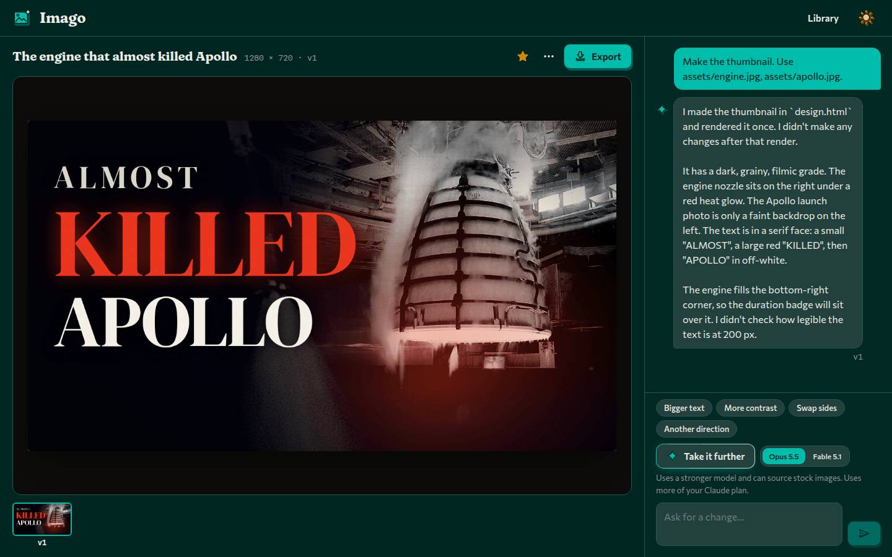
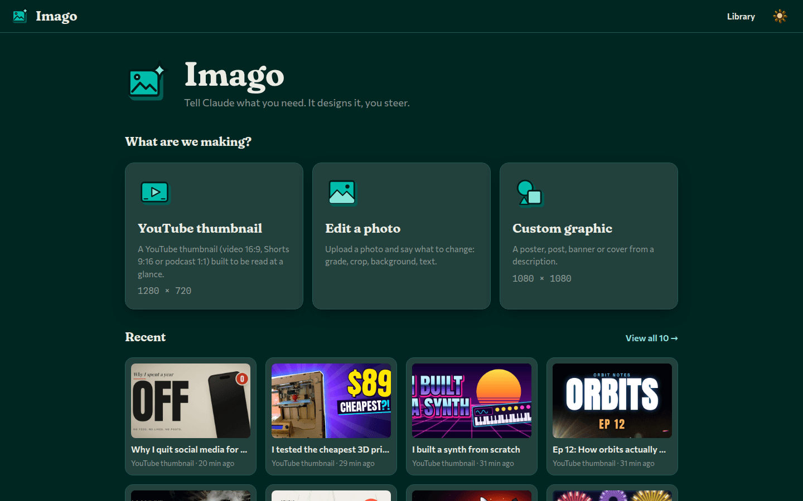
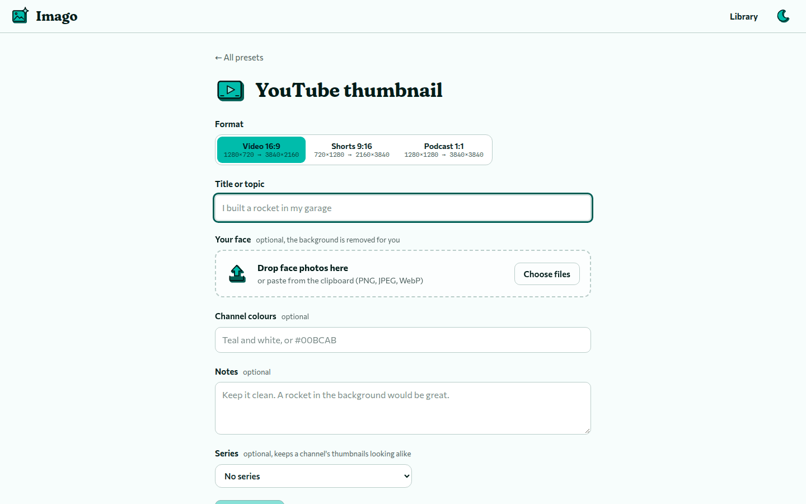
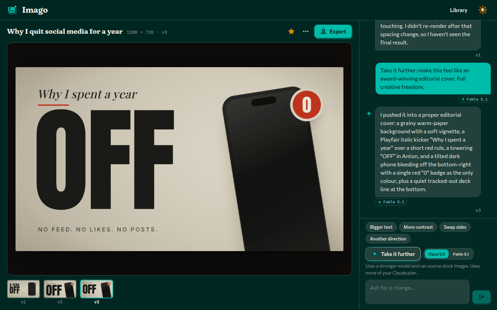
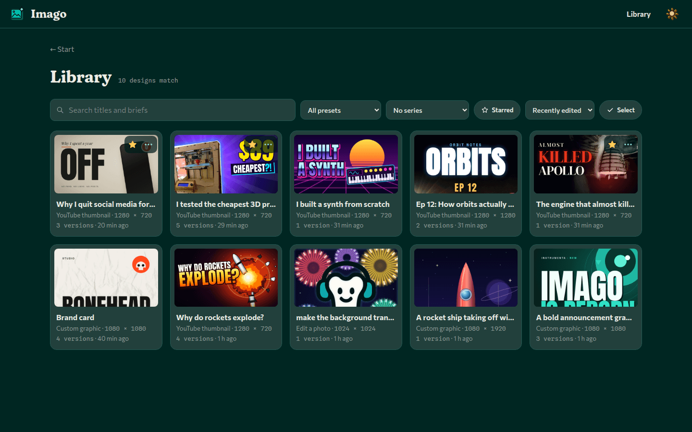

<p align="center"></p>

# Imago

Design thumbnails, photo edits and graphics with your own Claude Code. You describe the image
and Claude writes it as HTML, CSS and SVG, looks at its own render, and fixes what is wrong. You ask
for changes in plain words and export a PNG, JPG or WebP.

Version 0.2.0. It runs from source and needs Claude Code signed in; see [Requirements](#requirements).



## Requirements

- Node.js 22 (what it is built and tested on).
- **Claude Code**, installed and signed in, on the machine where the Imago server runs. When
  Instrumenta runs Imago on Windows that machine is the default WSL distribution, so install and sign
  in to `claude` there.
- Linux or WSL also needs a few Chromium libraries for the headless renderer. `npm install` fetches
  them without root into `tools/chromium-libs` (`npm run setup:libs` repeats that step).

`GET /api/capabilities` reports what is missing, and the start screen shows it with the fix.



## Running it

```bash
npm install
npm run build     # the UI, into web/dist
npm start         # server on http://127.0.0.1:49321
```

`npm run dev` runs the server and Vite together for working on the UI. Opening the page with
`?mock=1` runs the UI against canned data, with no server.

| Variable | Default | Meaning |
| --- | --- | --- |
| `PORT` | `49321` | Imago listens on `127.0.0.1` only. |
| `IMAGO_DATA_DIR` | `%LOCALAPPDATA%\Imago` on Windows, `~/.local/share/imago` elsewhere | Where projects live. |
| `IMAGO_MODEL` | `claude-sonnet-5-5` | Model passed to `claude`. |
| `IMAGO_EFFORT` | `medium` | Effort passed to `claude`. |
| `IMAGO_TURN_TIMEOUT_MS` | `600000` | A turn that runs longer is killed. |
| `IMAGO_FURTHER_MODELS`, `IMAGO_FURTHER_EFFORT` | `opus=claude-opus-5-5,fable=claude-fable-5-1`, `high` | Models and effort for Take it further. |
| `IMAGO_CLAUDE_BIN` | `claude`; on Windows the `claude.exe` found by `server/claude-bin.mjs` | The Claude Code executable. |
| `IMAGO_FABULA_PROJECTS` | Fabula's projects folder, and a sibling `Fabula/media` | Comma-separated roots searched for Fabula thumbnail kits. |
| `IMAGO_CONCEPT_CONCURRENCY` | `3` | How many concept design turns run at once. |

Each project is a folder under `<IMAGO_DATA_DIR>/projects/<id>/` holding `project.json`,
`design.html`, `assets/`, one snapshot and render per version, and `exports/`. Delete a project in
the app or delete its folder.

## Presets

| Preset | Starts from | Sizes |
| --- | --- | --- |
| YouTube thumbnail | The video's title or topic, optional channel colours, notes and face photos (cut out locally). | Video 16:9, Shorts 9:16 or Podcast 1:1. Designed at 1280 on the long side and exported at 3× (3840×2160, YouTube's current recommendation) as JPG by default |
| Edit a photo | One uploaded photo and an instruction. | The photo's own shape or one of nine crops (1:1, 4:5, 3:4, 2:3, 9:16, 4:3, 3:2, 16:9, 21:9). A crop always fits inside the photo, so it is never upscaled |
| Custom graphic | A description and optional reference images. | 32 named sizes grouped by platform (social networks, web, print at 150 dpi, screens) or any size from 64 to 4096 per side |

Exports go up to 8192 px on the long side. After a thumbnail export Imago shows the file size and
warns when it is over 2 MB, the limit for uploads from the YouTube mobile app (desktop allows 50 MB).



Each turn shows Claude Code's cost estimate (`total_cost_usd`). That is an API-price figure. On a
subscription nothing is charged for it; it is there so you can see what a turn weighs.

## Take it further

Ordinary turns run on Sonnet 5.5 at medium effort: quick and light on your plan. When a result is
not there yet, **Take it further** continues the same conversation on Opus 5.5 (the default) or
Fable 5.1 at high effort, with up to eight renders, web search, and openly licensed stock images from
Openverse (credits are kept and shown with the design). Fable uses the most of your plan. Anything
typed in the message box goes along as direction. The models and effort are set by
`IMAGO_FURTHER_MODELS` and `IMAGO_FURTHER_EFFORT`.



## Library and series

The Start screen shows the latest designs; **Library** holds all of them, with search, filters by
preset, series and starred, sorting, and loading forty at a time. Each design can be renamed,
starred, duplicated, moved to a series or deleted (with Undo; deleted designs are kept in a trash
folder for seven days). Select mode adds shift-click ranges and a bulk bar for delete, star, move and
downloading the renders as a zip.

A **series** keeps a channel's look consistent. **New in this style** starts a new design in the same
series with the source's render and HTML as a style reference, so the layout, type, colours and
badges carry over and only the episode's content changes. Only channel settings (colours, format)
carry over from the source's brief, never its episode notes.



## The design rules

Claude is told the same rules the server enforces on `design.html`:

- One complete HTML document, with a `body` exactly the image size, `margin: 0` and `overflow: hidden`.
- HTML, CSS and inline SVG only. No scripts, event attributes, frames or external links.
- No network. Every `src`, `href` and `url()` is a project file such as `assets/face.png`, or a
  `data:` URL.
- Fonts come from the bundled set in `fonts/` (Anton, Archivo, Bebas Neue, Inter, Playfair Display and others; licences in `fonts/licenses/`).
- At most four renders per turn: write, render, look, fix, stop.

Errors fail the render with a message Claude can act on. Warnings render and are passed back.

## In Instrumenta

Imago is a `managed-service` product, like Discere, and needs Instrumenta 0.16.0 or newer. The
launcher installs its Windows release, starts the bundled `runtime\node.exe server\index.mjs`, waits
for `/api/health` and opens the loopback address in a window. Updates arrive the same way. Imago runs
natively on Windows: it finds `claude.exe` itself (the native installer's
`%USERPROFILE%\.local\bin`, then PATH, then npm's package) and keeps its data in
`%LOCALAPPDATA%\Imago`. The first start on Windows copies `~/.local/share/imago` from WSL when
there is one, and leaves WSL as it was.

Without a release installed, a workspace's checkout runs as a `web-service`, the way it did before:
`git pull` in `Imago/`, then `npm ci` and `npm run build` (the launcher's Prepare does both). The
checkout's manifest is [`instrumenta/product.json`](instrumenta/product.json).

## Architecture

```text
server/       Node ESM, node:http only: HTTP and SSE, project store, claude runner,
              design.html validation, render MCP, cut-out
render/       render.cjs, headless Electron: design.html to png, jpg or webp
fonts/        content fonts for designs
web/          Vite, React and TypeScript UI, built to web/dist
tests/        node --test
```

A turn runs `claude -p` in the project folder with stream-json output, resumes the stored session,
and hands Claude one internal MCP server with two tools: `render` and `cut_out`. The server learns
about renders from the stream and pushes progress to the page over SSE. The full contract, including
the HTTP API, is in [docs/redesign-contract.md](docs/redesign-contract.md).

## Development and tests

```bash
npm test          # node --test tests/
npm run lint
npm run typecheck
npm run build
```

The tests never call the real Claude. `tests/fixtures/fake-claude.mjs` stands in for `claude -p`:
it writes a design, renders it through the real render MCP and prints stream-json, so no usage is
spent. Developer notes are in [CLAUDE.md](CLAUDE.md).

## Making a release

A release is a Windows bundle that Instrumenta installs as a `managed-service`, the same way it
installs Discere. Push a tag `v<version>` that matches `version` in `package.json` and
[`.github/workflows/release.yml`](.github/workflows/release.yml) runs on a Windows runner. It runs
`npm ci` and `npm run build`, then `scripts/package-release.mjs`, which stages
`.release/imago-<version>/` and zips it to `.release/imago-<version>.zip`.

The bundle has a pinned Node in `runtime/node.exe`, plus `server/`, `render/`, `fonts/`, `web/dist`
and the production `node_modules`. Electron stays in, since every render starts `electron.exe`. Its
own `instrumenta/product.json` starts `runtime/node.exe server/index.mjs` with `IMAGO_PACKAGED=1`;
the checkout's manifest is left as it is. `imago-bundle.json` at the root records the Imago, Node and
Electron versions.

Next, `scripts/smoke-release.mjs` runs on the bundled Node. It starts the server against a temporary
data folder, checks `/api/health`, the page and the renderer, renders a test page with and without a
font from `fonts/`, and cuts out a background. Instrumenta's `scripts/instrumenta-release.cjs` then
writes `instrumenta-release.json`, which asks for Instrumenta 0.15.0 or newer, and the workflow
publishes it with the zip. If you run the workflow by hand from the Actions tab, it builds and checks
everything and keeps the zip as a build artifact, but publishes nothing.

`node scripts/package-release.mjs --dry-run` lists what would be staged, on any platform. A real
bundle has to be staged on Windows, because the native parts are whatever `npm ci` installed there.

## Licence

Imago is MIT licensed (see [LICENSE](LICENSE)). The content fonts in `fonts/` and the bundled libraries
keep their own licences.

---

<sub>Part of [Instrumenta](https://github.com/George-Nizor/Instrumenta), made by [Bonehead Labs](https://boneheadlabs.org). Brand v2: teal, a framed picture with a sparkle, interface type Fraunces, Commissioner and Spline Sans Mono (SIL OFL 1.1, vendored in `web/public/brand/fonts/` with their licences). Licence: MIT.</sub>
